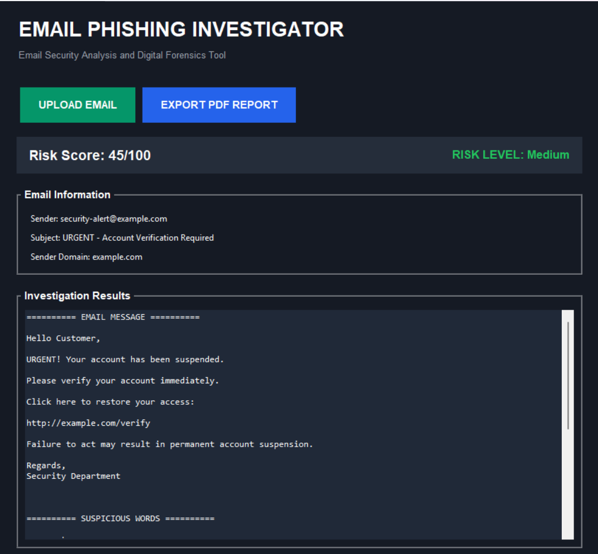
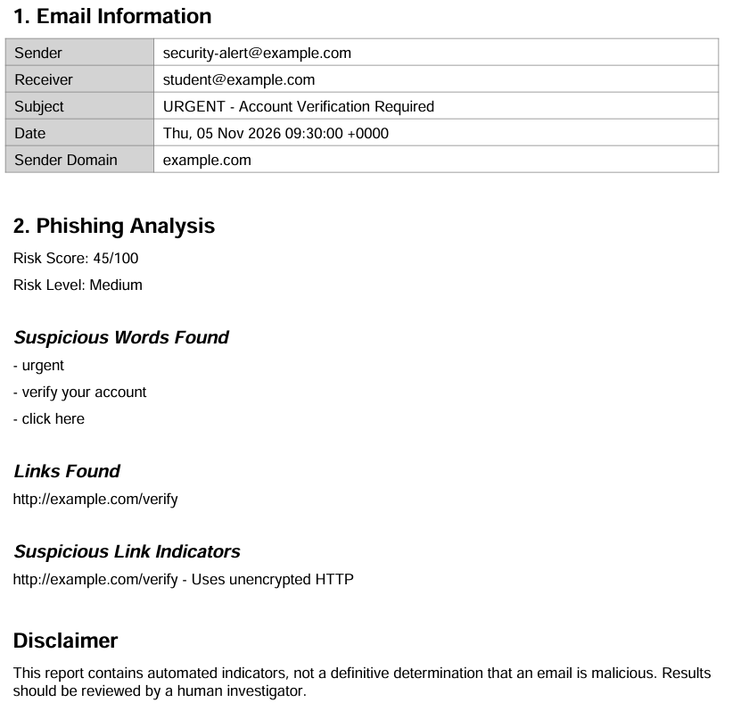

# Email Phishing Investigator

A Python desktop application that analyses `.eml` email files and identifies potential phishing indicators. Built as a personal cybersecurity and digital forensics project.

## Project Overview

The Email Phishing Investigator extracts information from email files and checks their contents for common phishing warning signs.

It uses a rule-based scoring system to provide an initial risk assessment and can generate PDF reports containing the investigation results.

## Application Screenshots

### Main Dashboard



### PDF Investigation Report



## Features

- **Email parsing:** Extracts sender, receiver, subject, date and message content.
- **Suspicious phrase detection:** Searches email content for common phishing-related phrases.
- **URL extraction:** Identifies website links contained in an email.
- **URL warning checks:** Flags HTTP links and recognised URL shorteners.
- **Sender information:** Extracts the sender's email address and domain for further investigation.
- **Risk assessment:** Calculates a rule-based score and categorises the result as Low, Medium or High.
- **Desktop interface:** Provides a graphical interface built with Tkinter.
- **PDF reporting:** Exports investigation findings into a structured PDF report.

## Technologies Used

- Python
- Tkinter
- Python Email package
- Regular Expressions
- ReportLab
- VS Code
- Git and GitHub

## Project Structure

```text
Email-Phishing-Investigator/
│
├── gui.py
├── main.py
├── email_parser.py
├── phishing_detector.py
├── report_generator.py
├── requirements.txt
├── .gitignore
├── README.md
│
├── samples/
│   └── test_email.eml
│
└── reports/
```

## Installation

### 1. Clone the repository

```bash
git clone YOUR-GITHUB-REPOSITORY-URL
```

### 2. Enter the project folder

```bash
cd Email-Phishing-Investigator
```

### 3. Create a virtual environment

```bash
py -m venv venv
```

### 4. Activate the environment on Windows

```powershell
.\venv\Scripts\Activate.ps1
```

### 5. Install the required packages

```bash
pip install -r requirements.txt
```

### 6. Run the application

```bash
python gui.py
```

## How to Use

1. Launch the desktop application.
2. Select **Upload Email**.
3. Choose an `.eml` email file.
4. Review the extracted email information.
5. Examine the suspicious phrases and URL warnings.
6. Review the calculated risk score.
7. Select **Export PDF Report** to save the investigation findings.

## Risk Scoring

The current scoring system uses simple rules:

| Indicator | Points |
|---|---:|
| Each suspicious phrase | 10 |
| Each suspicious link indicator | 15 |

The score is capped at 100.

| Score | Risk category |
|---|---|
| 0–29 | Low |
| 30–59 | Medium |
| 60–100 | High |

## Limitations

- The risk score is a basic heuristic, not a probability that an email is malicious.
- Suspicious phrases can appear in legitimate emails.
- HTTP links and URL shorteners are warning signs, not proof of malicious activity.
- Sender domain extraction does not verify whether a sender is genuine.
- The application does not currently perform SPF, DKIM or DMARC verification, attachment malware analysis, or live threat-intelligence checks.

All results should be treated as indicators requiring further investigation.

## Learning Objectives

This project helped develop practical skills in:

- Python programming and modular code design.
- Email parsing and digital forensics fundamentals.
- Regular expressions and URL extraction.
- Basic cybersecurity analysis.
- Desktop GUI development.
- Automated PDF report generation.

